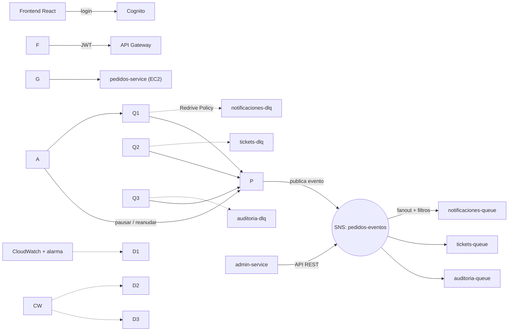
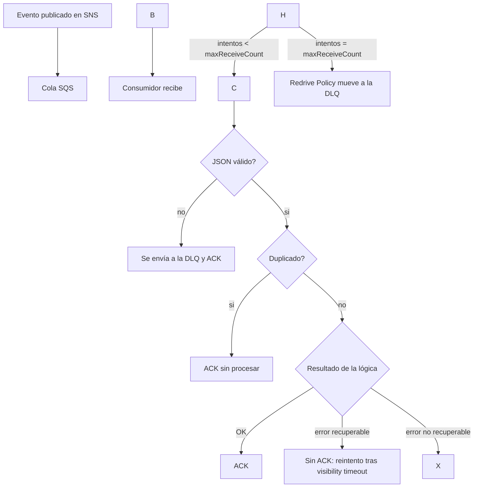

# Pedidos360 - Mensajería asíncrona con Amazon SNS y SQS

Evaluación Parcial N° 2 · DSY1107 Desarrollo Cloud Native I · Duoc UC

**Integrantes:** Tomás Cáceres · Ignacio Calderon

Escala el sistema Pedidos360 (Parcial 1) con una capa de mensajería asíncrona: cuando se crea un pedido o cambia su estado, el backend publica un evento en un tópico SNS que reparte el mensaje a tres colas SQS (notificaciones, tickets y auditoría), cada una con su DLQ. Un microservicio administrador permite operar toda la mensajería por API REST.

## Componentes

|Componente|Ubicación|Tecnología|
|-|-|-|
|`pedidos-service` (productor y consumidores)|raíz de este repo (`src/`)|Spring Boot 4.1.1, Java 17, Spring Cloud AWS 4.0.0|
|`admin-service` (administrador)|`admin-service/`|Spring Boot 4.1.1, Java 17, Spring Cloud AWS 4.0.0|
|Frontend|repo `tomasduoc-14/pedidos360-frontend`|React + TypeScript + Vite + Amplify (login con Cognito)|

Se mantiene lo del Parcial 1: base de datos en RDS (MySQL), validación del JWT de Cognito en el backend, login del frontend con Cognito y consumo del backend a través del API Gateway.

## Arquitectura



## Topología de mensajería

Tópico: `pedidos-eventos`. Todos los nombres y parámetros están centralizados en `src/main/resources/application.yml` (clase `MensajeriaProperties`) y la topología se declara en `MensajeriaTopologia`, separada de la lógica de negocio.

|Cola|Función|Eventos que recibe (filtro `tipoEvento`)|DLQ|
|-|-|-|-|
|`notificaciones-queue`|Avisos al cliente|`PEDIDO\_CREADO`, `PEDIDO\_ENVIADO`|`notificaciones-dlq`|
|`tickets-queue`|Generación de tickets/documentos|`PEDIDO\_CREADO`|`tickets-dlq`|
|`auditoria-queue`|Registro de todos los eventos|todos (sin filtro)|`auditoria-dlq`|

**Dos patrones de enrutamiento**

* **Fanout:** un `PEDIDO\_CREADO` llega a las tres colas. Se usa cuando varios dominios deben reaccionar al mismo hecho.
* **Entrega selectiva (filtros de suscripción):** un `PEDIDO\_ENVIADO` llega solo a notificaciones y auditoría, y un `PEDIDO\_ENTREGADO` solo a auditoría. Se usa cuando cada dominio solo necesita parte de los eventos. El productor envía el atributo `tipoEvento` y SNS filtra.

Las suscripciones usan **raw message delivery**: la cola recibe el JSON del evento tal cual, sin el sobre de SNS.

## Consumidores

Uno por dominio, con `@SqsListener` y confirmación manual (`MANUAL`):

* `mensajeria/consumidor/notificaciones/NotificacionesConsumidor`
* `mensajeria/consumidor/tickets/TicketsConsumidor`
* `mensajeria/consumidor/auditoria/AuditoriaConsumidor`

El flujo común está en `ProcesadorMensajes`:

|Situación|Qué hace|Log|
|-|-|-|
|Éxito|Ejecuta la lógica y confirma (ACK)|`OK eventoId=... intento=N (ACK)`|
|Mensaje duplicado|Confirma sin volver a procesar|`DUPLICADO ignorado ...`|
|Error recuperable|**No** confirma: SQS lo reentrega tras el visibility timeout; al llegar a `maxReceiveCount` la Redrive Policy lo mueve a la DLQ|`REINTENTO eventoId sqsId intento=N/M causa`|
|Error no recuperable (JSON inválido, datos inválidos)|Lo envía directo a la DLQ y confirma el original|`NO RECUPERABLE id intento causa -> enviado a <dlq>`|

Todos los registros incluyen id, intento y causa. Para la demostración, `TicketsConsumidor` falla si el producto del pedido es `FALLO\_RECUPERABLE` o `FALLO\_NO\_RECUPERABLE`; con `MENSAJERIA\_SIMULAR\_FALLOS=false` deja de fallar (sirve para mostrar el reproceso de la DLQ).

> Limitación conocida: la detección de duplicados se guarda en memoria de cada instancia. Con varias instancias, un mismo mensaje reentregado podría procesarse en otra. La mejora natural es registrar los `eventoId` procesados en la base de datos.

## Políticas de retención y limpieza

|Cola|Retención|Visibility timeout|maxReceiveCount|Justificación|
|-|-|-|-|-|
|`notificaciones-queue`|1 día|30 s|3|Un aviso viejo pierde valor; no conviene notificar algo obsoleto|
|`tickets-queue`|4 días|60 s|3|El documento debe generarse aunque el servicio esté caído un fin de semana; generar un ticket tarda más|
|`auditoria-queue`|7 días|30 s|5|El registro no debe perderse; más intentos porque es un fallo transitorio de escritura|
|Todas las DLQ|14 días (máximo)|-|-|Tiempo para investigar y reprocesar. La retención corre desde que el mensaje entró a la cola original, por eso la DLQ retiene más que su origen|

* El **visibility timeout** es mayor que el tiempo máximo de procesamiento, para que un mensaje en proceso no se entregue dos veces.
* **Limpieza:** la retención elimina automáticamente los mensajes viejos. Además el administrador puede purgar colas y DLQ (`POST /api/admin/queues/{nombre}/purge`, `POST /api/admin/dlq/{nombre}/purge`) y reprocesar la DLQ (`/redrive`). Así ninguna cola crece sin control.

## Monitoreo (CloudWatch)

Métricas por cola: mensajes disponibles (`ApproximateNumberOfMessagesVisible`), en proceso (`ApproximateNumberOfMessagesNotVisible`), antigüedad del mensaje más antiguo (`ApproximateAgeOfOldestMessage`) y mensajes en las DLQ.

|Métrica|Decisión que se toma|
|-|-|
|Mensajes disponibles|Si sube de forma sostenida, hay que levantar más instancias del consumidor|
|Mensajes en proceso|Si es alto, los consumidores están lentos o colgados|
|Antigüedad del mensaje más antiguo|Si se acerca a la retención, se está por perder mensajes|
|Mensajes en DLQ|Cualquier valor mayor a 0 es un fallo que hay que investigar|

**Alarma:** una alarma por DLQ sobre `ApproximateNumberOfMessagesVisible >= 1` (período de 1 minuto), creada en la consola de CloudWatch.

## Microservicio administrador

Detalle de la API en [`admin-service/README.md`](admin-service/README.md). Resumen:

* Colas: crear, eliminar, listar, estado, purgar
* Tópicos: crear, eliminar, listar
* Suscripciones: crear (con filtro), listar, eliminar
* DLQ: estado, reprocesar, purgar
* Consumidores: listar, pausar, reanudar (llama al endpoint interno `/internal/consumidores/\*\*` de cada instancia de `pedidos-service`)

## Cómo ejecutar

Requisitos: Java 17 o superior, credenciales del AWS Academy Learner Lab. **Las credenciales y las claves nunca se suben al repositorio**: se pasan como variables de entorno.

```powershell
$env:AWS\_ACCESS\_KEY\_ID='...'
$env:AWS\_SECRET\_ACCESS\_KEY='...'
$env:AWS\_SESSION\_TOKEN='...'
$env:AWS\_REGION='us-east-1'
$env:MENSAJERIA\_TOPOLOGIA\_HABILITADA='true'   # crea tópico, colas y suscripciones al arrancar
$env:ADMIN\_API\_KEY='<clave del administrador>'
```

**pedidos-service** (puerto 8080):

```powershell
.\\mvnw.cmd spring-boot:run
# con la base de datos en RDS:
$env:RDS\_PASSWORD='...'; .\\mvnw.cmd spring-boot:run "-Dspring-boot.run.profiles=rds"
```

**Segunda instancia del consumidor** (para la demostración de disponibilidad), en otra terminal:

```powershell
.\\mvnw.cmd spring-boot:run "-Dspring-boot.run.arguments=--server.port=8082"
```

**admin-service** (puerto 8090):

```powershell
.\\mvnw.cmd -f admin-service\\pom.xml spring-boot:run
```

Sin `MENSAJERIA\_TOPOLOGIA\_HABILITADA=true` el backend arranca igual (con un publicador vacío), útil para desarrollo local con H2.

## Flujo de un mensaje



